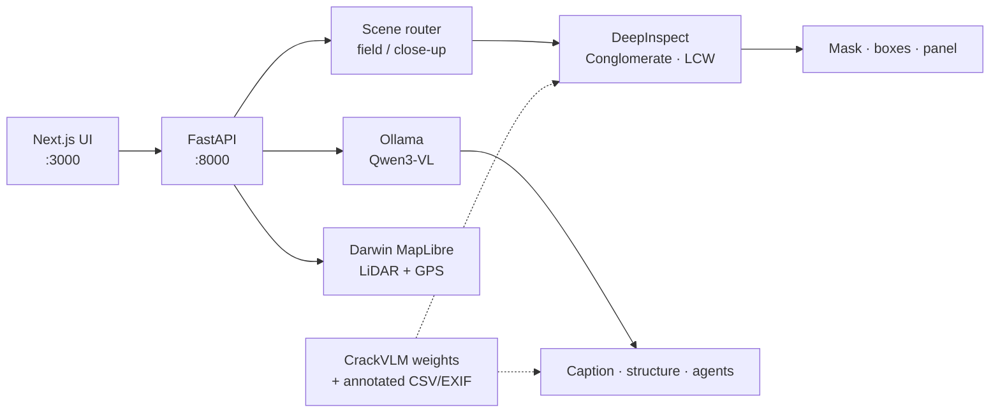

# CrackInspect

**Infrastructure crack inspection for engineers** — upload field or close-up photos, get real DeepInspect segmentation overlays, structured VLM reports, and Darwin 3D LiDAR context with photo GPS.

<p align="center">
  <a href="#features">Features</a> ·
  <a href="#architecture">Architecture</a> ·
  <a href="#quick-start">Quick start</a> ·
  <a href="#configuration">Configuration</a> ·
  <a href="#api">API</a> ·
  <a href="#project-structure">Structure</a>
</p>

<p align="center">
  
  
  
  
  
  
</p>

---

## Why CrackInspect?

Most demos draw fancy boxes. CrackInspect is built for **inspection workflows**:

- **Real masks** from DeepInspect (Conglomerate + LCW), not decorative overlays  
- **Honest measurements** — mm / GPS only from CSV + EXIF when metadata exists  
- **Scene-aware routing** — field photos → LCW; close-ups → Conglomerate  
- **Bilingual UI** — Vietnamese / English end-to-end (including burned-in panel captions)  
- **Spatial context** — Darwin satellite + WebGL LiDAR 3D + photo GPS pins with reverse-geocoded addresses  

---

## Features

| Area | What you get |
|------|----------------|
| **Detection** | Pixel crack masks, instance boxes, severity, axis, optional SIFT refine |
| **Evaluation** | 4-panel view (Original / GT / Prediction / TP·FP·FN) when ground truth exists |
| **Vision-language** | Qwen3-VL scene captions, structure JSON, multi-agent condition pipeline, chat Q&A |
| **Enhancement** | Close-up inspect + optional Real-ESRGAN / BasicVSR++ sharpen paths |
| **Darwin map** | Esri imagery, MapLibre 3D LiDAR point cloud, intensity/height coloring |
| **Photo GPS** | EXIF/CSV coordinates → map markers + Nominatim address (cached) |
| **i18n** | VI / EN for UI, reports, overlay captions, quality notes |

---

## Architecture



**Design notes**

- Detector weights and annotated datasets stay in **CrackVLM** (`CRACKVLM_ROOT`) — this repo does not vendor multi-GB assets.  
- Runtime artifacts (`store/`), LiDAR (`Data/`), and local models (`models/`) are **gitignored**.  
- Avoid stacking DeepInspect + Ollama hard on a single 8 GB GPU without the built-in unload / pool controls.

---

## Tech stack

| Layer | Stack |
|-------|--------|
| Frontend | Next.js 15, React 19, TypeScript, MapLibre GL |
| Backend | FastAPI, Uvicorn, OpenCV, Pillow, NumPy |
| Detection | PyTorch DeepLab weights (Conglomerate / LCW) |
| VLM | Ollama (`qwen3-vl:4b` by default) |
| LiDAR | `laspy`, `pyproj`, WebGL custom layer |
| Optional | BasicVSR++, Real-ESRGAN, Qwen 3D-Coder (llama.cpp) |

---

## Quick start

### Prerequisites

- Python **3.10+** with **PyTorch CUDA** (reuse the CrackVLM env)  
- Node.js **20+**  
- [Ollama](https://ollama.com) with `qwen3-vl:4b`  
- CrackVLM checkout containing Conglomerate / LCW weights (and annotated data if you need mm/GPS eval)

### 1. Clone & environment

```bash
git clone <your-repo-url> CrackInspect
cd CrackInspect
cp .env.example .env   # edit CRACKVLM_ROOT if needed
```

```bash
# Backend deps (in your CrackVLM / CUDA venv)
cd backend
pip install -r requirements.txt
```

```bash
# Frontend
cd ../frontend
npm install
```

### 2. Run

```powershell
# Terminal A — API
cd backend
python -m uvicorn app:app --host 127.0.0.1 --port 8000

# Terminal B — UI
cd frontend
npm run dev
```

| Service | URL |
|---------|-----|
| Web app | http://127.0.0.1:3000 |
| Darwin map | http://127.0.0.1:3000/darwin |
| API health | http://127.0.0.1:8000/health |
| OpenAPI | http://127.0.0.1:8000/docs |

---

## Configuration

Copy `.env.example` → `.env` (or export env vars):

| Variable | Default | Purpose |
|----------|---------|---------|
| `CRACKVLM_ROOT` | `E:\Dự án FPT\CrackVLM` | Weights + annotated datasets |
| `OLLAMA_HOST` | `http://127.0.0.1:11434` | Ollama endpoint |
| `OLLAMA_VL_MODEL` | `qwen3-vl:4b` | Vision-language model |
| `NEXT_PUBLIC_API_URL` | `http://127.0.0.1:8000` | Frontend → API |
| `CRACKINSPECT_VLM_ROUTE` | `0` | `1` = Ollama scene routing |
| `CRACKINSPECT_MULTI_AGENT` | `0` | `0` / `1` / `full` assessors |
| `CRACKINSPECT_SCENE_CAPTION` | `1` | VLM scene captions |
| `CRACKINSPECT_KEEP_MODELS` | `1` | Keep DeepInspect weights warm |
| `CRACKINSPECT_LIDAR_MAP` | `Data/Pointcloud off grounds` | Darwin LAS corridor |

---

## Usage

1. Open the web app → choose **VI / EN**.  
2. Drop JPG/PNG (Conglomerate close-ups and/or LCW field shots).  
3. Set image source if known → **Detect**.  
4. Review **DeepInspect** overlay, **Panel 4** metrics, crack list, VLM / structure tabs.  
5. Open **Darwin Map** to see LiDAR + GPS pins from the latest Detect batch (when EXIF/CSV has coordinates).

> **Note:** Panel text language follows the UI language at Detect time. Switch language and Detect again to refresh burned-in captions.

---

## API

| Method | Path | Description |
|--------|------|-------------|
| `GET` | `/health` | Weights, speed flags, LiDAR status |
| `POST` | `/analyze` | Multipart `files` + `source_kind` + `lang` |
| `POST` | `/analyze-sample` | Built-in sample images |
| `POST` | `/chat` | Session Q&A over analyzed images |
| `GET` | `/last` | Last session records |
| `GET` | `/session/gps` | GPS points for Darwin (`lang`, `include_all`) |
| `GET` | `/lidar/map-overlay` | Downsampled WGS84 LiDAR for MapLibre |
| `POST` | `/lidar/build` | Three.js LAS viewer |
| `GET` | `/sharpen` | Close-up enhance |
| `GET` | `/closeup` | Close-up VLM description |

Interactive docs: **http://127.0.0.1:8000/docs**

---

## Project structure

```text
CrackInspect/
├── backend/
│   ├── app.py                 # FastAPI entry
│   ├── requirements.txt
│   └── crackinspect/          # detection, overlay, VLM, LiDAR, agents
├── frontend/
│   └── app/                   # Next.js UI + /darwin map
├── scripts/                   # helper scripts (e.g. 3D coder download)
├── tests/
├── store/                     # runtime only (gitignored contents)
├── Data/                      # local LiDAR (gitignored)
├── models/                    # local GGUF / extras (gitignored)
├── .env.example
├── .gitignore
└── README.md
```

---

## What is not in git

Large / generated assets are intentionally excluded:

- `Data/` — LiDAR point clouds  
- `models/` — local LLM / weight dumps  
- `store/` — uploads, overlays, session JSON  
- `*.pt` / `*.pth` / `*.gguf` — checkpoints  

Point `CRACKVLM_ROOT` at your CrackVLM tree for production weights.

---

## Roadmap

- [ ] Video / live camera ingest  
- [ ] Persisted inspection history UI  
- [ ] Packaged desktop launcher  
- [ ] Stronger offline geocoding fallback  

---

## License

Private / internal FPT project unless otherwise stated by the owners.

---

<p align="center">
  <b>CrackInspect</b> — DeepInspect · Vision-Language · Darwin LiDAR<br/>
  Built for concrete infrastructure inspection workflows.
</p>
